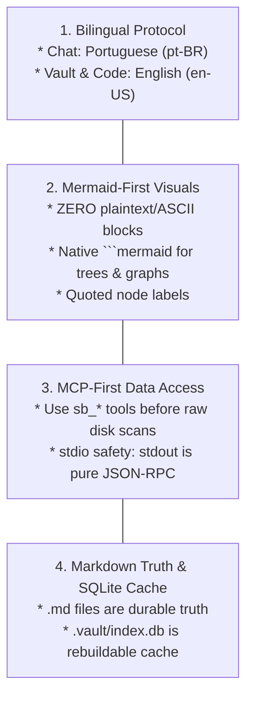

# Workspace Governance and Operating Rules

This rule specification governs all AI coding agents (Google Antigravity, Anthropic Claude Code, Cursor) operating in this repository or in an initialized Second Brain vault.



---

## 1. Bilingual Governance

* **Human Dialogue:** Communicate with the human operator strictly in **Portuguese (pt-BR)** in IDE chat sessions.
* **Repository Artifacts:** Write all code, comments, documentation, ADRs, schemas, commit messages, and note contents strictly in **English (en-US)**.
* **Exceptions:** Third-party raw material placed inside `INPUT/` retains its native language as raw data.

---

## 2. Mermaid-First Visual Standards (Zero ASCII Art)

* Never use ` ```text `, ` ```plaintext `, or ASCII character trees (`├──`, `└──`, `|--`) in Markdown documents.
* Always represent folder structures, graph relationships, workflows, and lifecycles using native **` ```mermaid `** diagrams (`flowchart`, `graph`, `erDiagram`, `sequenceDiagram`, `stateDiagram-v2`, `mindmap`).
* Always wrap node labels containing spaces, brackets, parentheses, or punctuation in double quotes:
  ```mermaid
  flowchart LR
    A["Node: ZET-0001 (Main)"] --> B["Node: CON-0002 (Concept)"]
  ```

---

## 3. Tool Access Priority & Model Context Protocol (MCP)

* Always prefer executing operations through the native Second Brain MCP tools when interacting with vault knowledge:
  1. `sb_assemble_context`: For contextual grounding within token budgets ($4\text{k}$, $16\text{k}$, $64\text{k}$).
  2. `sb_search_knowledge`: For hybrid FTS5 and graph queries.
  3. `sb_get_node_graph`: For multi-hop link exploration.
  4. `sb_upsert_node`: For atomic Zod-validated note authoring.
  5. `sb_lint_vault`: For health checks.
  6. `sb_index_vault`: For forced index rebuilds.
* Direct CLI invocation (`sb <command>`) serves as the secondary execution method.

---

## 4. Ephemeral Index Integrity

* Treat Markdown files with YAML frontmatter as the **exclusive durable state**.
* Never check `.vault/index.db` into git. The index must be treated as completely disposable and rebuildable at any time via `sb index`.

