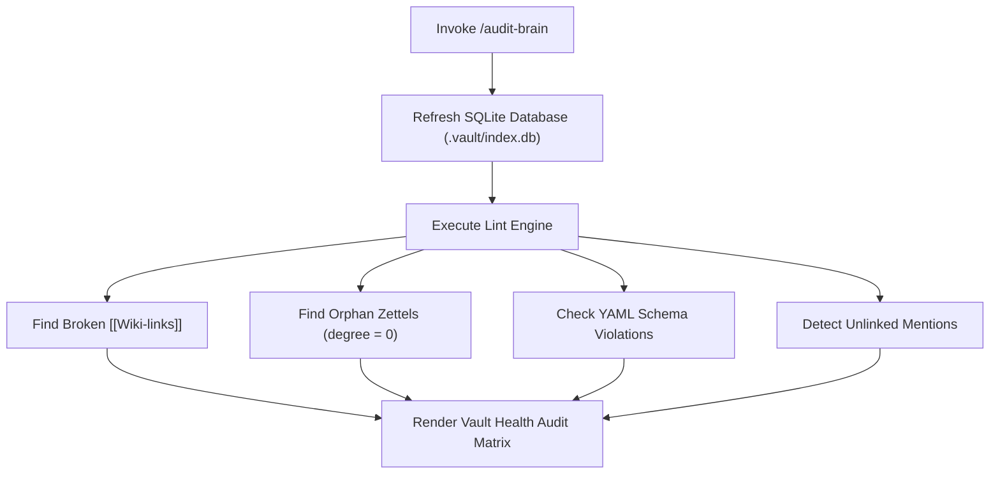

# /audit-brain — Vault Health Audit Skill

This skill performs a complete health inspection of the knowledge vault.



---

## Instructions

1. **Trigger Audit:**
   Execute the lint tool via MCP (`sb_lint_vault`) or CLI:
   ```bash
   sb lint .
   ```
2. **Evaluate Severity:**
   * **Errors:** Broken links pointing to non-existent UIDs (must be fixed).
   * **Warnings:** Orphan zettels without inbound or outbound links, schema violations.
   * **Info:** Unlinked mentions that could be converted to typed `[[Wiki-links]]`.
3. **Generate Action Plan:**
   Present the audit table to the operator with concrete suggestions to resolve each finding.

