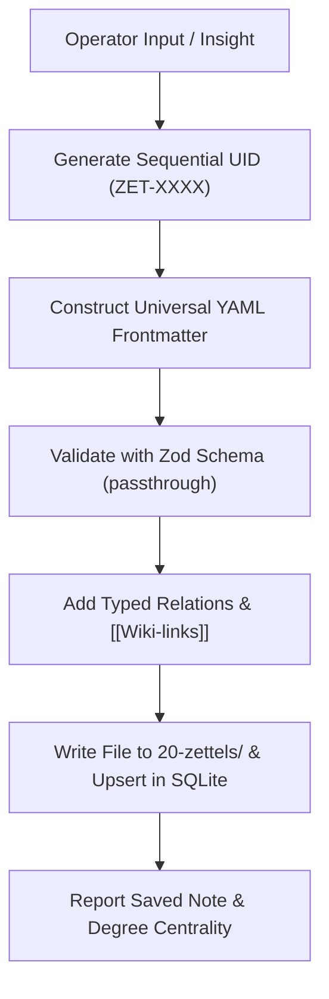

# /capture-zettel — Atomic Note Capture Skill

This skill captures a discrete insight as an atomic Zettel note adhering to the universal YAML envelope.



---

## Frontmatter Requirements

Every note captured via this skill MUST follow this envelope:

```yaml
---
uid: ZET-XXXX
type: zettel
title: "Single Atomic Concept"
aliases: []
tags: []
status: permanent
epistemic_confidence: 0.8
created: "YYYY-MM-DD"
updated: "YYYY-MM-DD"
summary: "1-2 sentence core distillation."
relations:
  - to: TARGET-UID
    rel: supports | contradicts | extends | part_of
    weight: 0.9
---
```

## Tool Execution

Always prefer `sb_upsert_node(relPath, content)` via the MCP server to ensure both disk and SQLite WAL indices are atomically synchronized.

