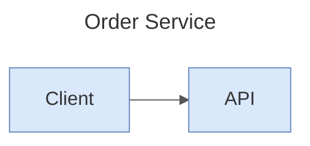
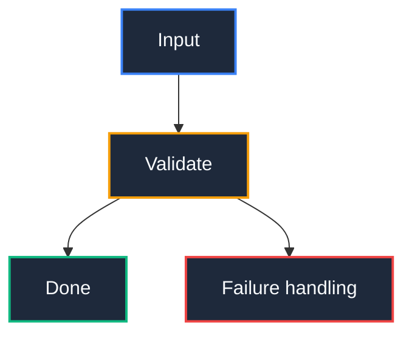

# Mermaid Diagram Engineering

Use this skill whenever an architecture, workflow, data model, state progression, chronology, or entity relationship is clearer as a picture than as dense prose, or when an existing Mermaid block is broken or hard to read.

Method adapted from the official Mermaid Chart VS Code extension (MIT): its generate → validate → preview loop, its semantic-preservation rules and its per-type syntax guidance. Account-bound features (cloud sync, login, AI credits, telemetry) are deliberately not replicated.

---

## 1. Workflow

1. **Classify** the need and pick the diagram type (section 3). Do not default to `flowchart`.
2. **Inventory first.** List every entity, actor, state or step and every relationship before writing syntax. For code input, read the real files; never invent components.
3. **Write** the diagram. Persist it as a `.mmd` file when it is a standalone artifact; embed it in a fenced ```` ```mermaid ```` block when it belongs inside a note.
4. **Validate** (section 7) before presenting. Never hand over unvalidated syntax as if it were verified.
5. **Repair** on failure: fix the first reported error, re-validate, repeat. Do not rewrite the diagram wholesale to fix one line.
6. **State what was checked**: say whether a real parser/renderer ran or only the manual checklist.

---

## 2. Core Invariants

1. **Zero ASCII art.** Never draw box-and-arrow diagrams with `+--`, `|`, `+`. Always use a ```` ```mermaid ```` fence.
2. **Quote labels** that contain parentheses, brackets, colons, quotes or other punctuation (quote any label with spaces to be safe): `id1["API Gateway (FastAPI)"]`, not `id1[API Gateway (FastAPI)]`.
3. **Avoid HTML in labels** (`<b>`, `<span>`, scripts). The one tolerated exception is `<br/>` for a line break in a quoted flowchart label when the target renderer supports it; otherwise split the idea across nodes.
4. **Reserved words**: a node id of `end` breaks flowcharts; use `End` or `done`. An id starting with `o` or `x` right after `---` can be read as an edge marker; add a space or capitalise.
5. **Stable ids, human labels**: ids are short ASCII (`authSvc`), display text lives in the label. Keep existing ids when editing.
6. **One idea per diagram.** If prose is shorter than the diagram, use prose or a table instead.
7. **Size limits**: the reference extension allows up to 90,000 characters and 1,000 edges, but stock Mermaid and `mmdc` default to `maxTextSize` 50000 and `maxEdges` 500; stay under those unless you raise them in the renderer config. Past roughly 30 nodes, split by domain into several diagrams or `subgraph`s; do not ship a hairball.
8. **Comments** use `%% text` on their own line. A `%%{init: ...}%%` directive is legacy; prefer frontmatter (section 5).

---

## 3. Diagram Type Selection

The first line after any frontmatter and `%%` comments is the type keyword. Keep it exact; never convert one type into another when editing.

| Need | Type | Keyword(s) |
|:---|:---|:---|
| Architecture, pipelines, decisions | Flowchart | `flowchart TD` / `LR` (legacy `graph`) |
| Messages over time, API calls, protocols | Sequence | `sequenceDiagram` |
| Object/module structure, interfaces | Class | `classDiagram` |
| Tables, entities, cardinalities | ER | `erDiagram` |
| Lifecycles, status machines | State | `stateDiagram-v2` |
| System context / containers / components | C4 | `C4Context`, `C4Container`, `C4Component`, `C4Dynamic`, `C4Deployment` |
| Cloud / CI-CD infrastructure with icons | Architecture | `architecture-beta` |
| Grid-style layouts and layered blocks | Block | `block-beta` |
| Chronology of eras and events | Timeline | `timeline` |
| Schedules and dependencies | Gantt | `gantt` |
| Branching history | Git graph | `gitGraph` |
| Hierarchical decomposition | Mindmap | `mindmap` |
| Task board | Kanban | `kanban` |
| User experience scoring | Journey | `journey` |
| Proportions | Pie | `pie` |
| Prioritisation 2x2 | Quadrant | `quadrantChart` |
| Numeric series | XY chart | `xychart-beta` |
| Flow volumes | Sankey | `sankey-beta` |
| Requirements traceability | Requirement | `requirementDiagram` |
| Wire/binary formats | Packet | `packet-beta` |
| Multi-axis comparison | Radar | `radar-beta` |

`-beta` keywords change between Mermaid releases. If a beta type fails to parse, check the renderer version before assuming the syntax is wrong.

---

## 4. Syntax Cheatsheet (what to use per type)

**Flowchart**
- Direction: `TB`, `TD`, `BT`, `LR`, `RL`. `TD` for hierarchies, `LR` for time/flow.
- Shapes: `[rect]` `(rounded)` `((circle))` `{decision}` `[(database)]` `[[subroutine]]` `{{hexagon}}` `[/io/]`. Semantic shapes (v11.3+): `A@{ shape: db }`, `diam`, `stadium`, `doc`, `hex`, `lean-r`.
- Edges: `-->` `---` `-.->` `==>` `--o` `--x` `<-->`; label with `A -->|text| B`. Extra dashes span more ranks (`---->`).
- Group with `subgraph id ["Title"] ... end`; a per-subgraph `direction LR` is ignored when a node inside links outside it.
- Style roles with `classDef` + `class a,b role` or `a:::role`. Escape commas in CSS values inside `classDef` (`stroke-dasharray:5\,5`). `linkStyle 0,2 stroke:#b85450`.
- Crossing-heavy graphs (15+ nodes, many back-edges): add `config: layout: elk` in frontmatter, but only if the target renderer has the ELK layout available (it must be registered separately in many setups); otherwise split the graph.

**Sequence**
- `participant A as Display Name` / `actor U as User` (no quotes around the alias); group with `box rgb(200,230,200) Backend ... end`.
- Arrows: `->>` sync, `-->>` reply, `-)` async, `-x` lost; `->>+B` / `-->>-A` activate/deactivate.
- Blocks: `loop`, `alt/else`, `opt`, `par/and`, `critical/option`, `break`, `rect rgba(...)`; `autonumber`; `note over A,B: text`.
- Add control-flow blocks only when they reflect real logic.

**Class**
- Visibility `+ - # ~`; `<<interface>>`, `<<abstract>>`, `<<enum>>`; generics `List~String~`; `namespace X { class A }`.
- Relations: `<|--` inheritance, `*--` composition, `o--` aggregation, `-->` association, `..|>` realization, cardinality in quotes `"1" --> "many"`.

**ER**
- `ENTITY { type name PK }`, keys `PK`, `FK`, `UK`; cardinalities `||--o{`, `}|--|{`, `|o--o|`.
- Solid `--` identifying, dashed `..` non-identifying. Copy cardinality markers character for character.

**State**
- Prefer `stateDiagram-v2`; composite `state X { ... }`, `<<choice>>`, `<<fork>>`/`<<join>>`, concurrency separator `--`, `[*]` start/end.
- `classDef` cannot style `[*]` or composite container boundaries.

For any type not listed here, consult the official syntax page for that type before writing; do not guess keywords.

---

## 5. Frontmatter, Themes, and Styling

Frontmatter must be the very first lines, before the type keyword:



- `themeVariables` only work with `theme: base`. Named themes (`default`, `neutral`, `dark`, `forest`, and in recent versions `redux`, `redux-dark`, `neo`, `neo-dark`) take no variables.
- Colours must be hex (`#rrggbb`/`#rgb`); the theming engine ignores CSS names like `red`.
- A diagram-level `title:` goes in frontmatter, not in a node.
- A custom `id:` in frontmatter is only meaningful to the Mermaid Chart cloud sync; do not add it.

### High-contrast class palette (readable in light and dark themes)



Colour must carry meaning (domain, risk, status). Do not colour for decoration, and never rely on colour alone: the label must say the same thing.

---

## 6. Generation Recipes (from source material)

Read the actual files, then map:

| Request | Read | Output |
|:---|:---|:---|
| Diagram from code | entry points, imports, public API | `flowchart` of modules/calls, or `classDiagram` for OO code |
| Execution sequence | the call path for one scenario | `sequenceDiagram`, one scenario per diagram |
| ER from schema | migrations, ORM models, SQL DDL | `erDiagram` with PK/FK and exact cardinalities |
| Cloud / CI-CD | IaC, workflow files | `architecture-beta` or `flowchart` with subgraphs per environment |
| Docker | `Dockerfile`, compose files | services, networks, volumes, ports as `architecture-beta` or `flowchart` |
| C4 top-down | repo layout, deployment configs | `C4Context` then `C4Container`; one level per diagram |
| Dependencies | lockfiles, manifests | `flowchart LR` of direct dependencies; mark risky or outdated ones |
| Ownership | `CODEOWNERS`, git history | `flowchart` grouping paths by owner |

Rules: every node must trace to a file, config key or documented fact. Mark inferences in a `%%` comment. If a source is missing, say so instead of filling the gap.

---

## 7. Validation

Run the strongest check available, and report which one ran.

1. **Parser/renderer (preferred).** If Node is available: `npx -y @mermaid-js/mermaid-cli -i diagram.mmd -o diagram.svg`. A non-zero exit or error text is the validation result. If the project already has a Mermaid linter or preview tool, use that. Nothing here is verified until the command has actually run.
2. **Manual checklist** (when no parser is available; state clearly that this is not a parse):
   - [ ] Fenced as ```` ```mermaid ```` (or a `.mmd` file) and frontmatter is first.
   - [ ] First keyword is a valid type from section 3.
   - [ ] Brackets, quotes, `subgraph`/`end`, `alt`/`end` blocks are balanced.
   - [ ] Labels with special characters are quoted; no HTML; no id named `end`.
   - [ ] Arrow syntax matches the type (`-->` in flowcharts, `->>` in sequences).
   - [ ] Every inventoried entity and relationship appears.
   - [ ] Under the size limits in section 2.

---

## 8. Editing, Repairing, and Improving Existing Diagrams

**Semantic preservation (mandatory for any edit):**
- Keep the diagram type. Never turn an `erDiagram` into a flowchart.
- Keep every node, participant, class, state, task and edge. Omit one only to fix an obvious duplicate or a syntax error, and say so.
- Keep labels, attributes, stereotypes, multiplicity, transition text and message order.
- Do not merge distinct concepts or split one concept; do not flatten a hierarchy into a chain.
- ER: never change cardinality markers, line style or relationship labels. Flowchart: never rewire an edge. Sequence: never reorder messages. State: keep composite states and `--` separators.

**Repair:** reproduce the parser error, fix the smallest cause (usual suspects: unquoted label, reserved `end`, wrong arrow for the type, unbalanced block, frontmatter not first), re-validate.

**Improve** with two independent passes, each reviewed against the preservation rules:
- *Layout*: group related nodes in named `subgraph`s, use semantic shapes for databases, decisions and terminals, set direction deliberately, add ELK for dense graphs.
- *Styling*: keep the same flat structure, add `classDef` roles or `themeVariables` by domain.

After an improvement, diff node and edge counts against the original; they must match.

---

## 9. When Not to Use a Diagram

Use a table or list when there are fewer than three relationships, when the relationships are purely hierarchical and shallow, or when the reader needs exact values rather than structure.
