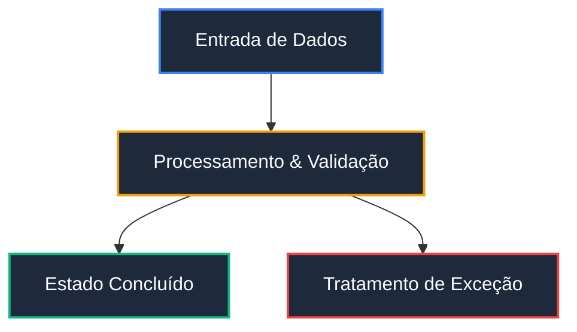

# Mermaid Diagram Engineering

Use this skill whenever an architecture, workflow, data model, state progression, chronology, or entity relationship benefits from visual representation rather than dense paragraphs.

---

## 1. Core Invariants & Rules

1. **Zero ASCII Art:**
   - NEVER generate box-and-arrow diagrams using text characters (`+--`, `|`, `+`).
   - Always place diagrams in a fenced code block with language identifier ````mermaid`.
2. **Deterministic Label Quoting:**
   - Always enclose node labels in double quotes if they contain spaces, parentheses, brackets, colons, numbers, or punctuation:
     - Correct: `id1["API Gateway (FastAPI)"]`
     - Incorrect: `id1[API Gateway (FastAPI)]`
3. **Zero HTML in Labels:**
   - Do not inject `<br>`, `<b>`, `<span>`, or raw HTML inside node labels. Use standard newlines or supported markdown styling.
4. **Visual Signal over Clutter:**
   - A diagram must communicate structure faster and clearer than prose. If a simple 2-row table or list is clearer, use that instead.

---

## 2. Diagram Type Selection Guide

| Need / Purpose | Mermaid Diagram Type | Syntax Starter | Best Practices |
|:---|:---|:---|:---|
| **Arquitetura, Pipelines & Fluxos** | `flowchart TD` ou `LR` | `flowchart TD` | Use direções consistentes (`TD` para hierarquias, `LR` para tempo/fluxo). Subgraphs para isolar contextos. |
| **Linhas Temporais & Cronologias** | `timeline` | `timeline` | Agrupe marcos e eventos por fases/épocas sem superlotação. |
| **Interações & Protocolos de Mensagens** | `sequenceDiagram` | `sequenceDiagram` | Mostre chamadas síncronas/assíncronas, atores e loops de confirmação. |
| **Ciclos de Vida & Máquinas de Estado** | `stateDiagram-v2` | `stateDiagram-v2` | Represente transições de estado, condições de guarda e estados finais. |
| **Modelagem de Dados & Relações de Entidades** | `erDiagram` ou `classDiagram` | `erDiagram` | Explicite cardinalidades (`||--o{`) e atributos chave. |
| **Mapas Mentais & Decomposição Conceitual** | `mindmap` | `mindmap` | Estruture tópicos em níveis hierárquicos expansíveis. |

---

## 3. Padrão Estético de Classes Modernas (Alto Contraste)

Para garantir excelente legibilidade tanto em temas claros quanto escuros (Obsidian, GitHub, IDEs):



---

## 4. Checklist de Validação Rápida

- [ ] O bloco de código está delimitado por ````mermaid`?
- [ ] Rótulos com caracteres especiais ou parênteses estão entre aspas duplas `["..."]`?
- [ ] O diagrama está livre de tags HTML brutas?
- [ ] O tipo de diagrama escolhido é o ideal para o problema em questão?

