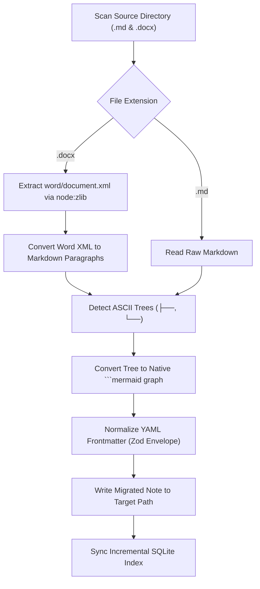

# /migrate-notes — Vault Ingestion & Migration Skill

This skill guides the agent in safely ingesting external or legacy document collections into the Second Brain vault without data loss.



---

## Execution Protocol

1. **Dry-Run First:**
   Always perform a dry-run migration first to preview converted files and Mermaid transformations:
   ```bash
   sb migrate <sourceDir> <targetDir> --dry-run
   ```
2. **Review Output:**
   Inspect the dry-run summary for errors or malformed documents.
3. **Execute Real Migration:**
   ```bash
   sb migrate <sourceDir> <targetDir>
   ```
4. **Re-index & Lint:**
   ```bash
   sb index <targetDir>
   sb lint <targetDir>
   ```

