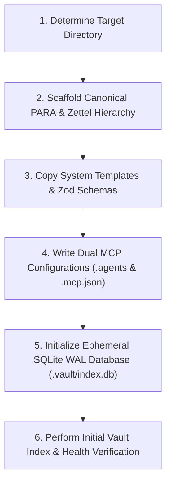

# /new-brain — Vault Initialization Skill

This skill guides the agent in bootstrapping a clean Second Brain vault instance.



---

## Execution Steps

1. **Verify Target Path:** Ask the operator for the destination folder or default to the current active workspace.
2. **Execute Scaffolder:**
   Run the CLI init command:
   ```bash
   sb init <targetPath> --name "Second Brain"
   ```
3. **Verify Folder Hierarchy:**
   Ensure the following directories exist:
   * `10-inbox/` (raw captures and drop zone)
   * `20-zettels/` (atomic zettelkasten notes)
   * `30-concepts/` (synthesis and evergreen concepts)
   * `40-projects/` (active PARA projects)
   * `50-areas/` (long-term PARA areas of responsibility)
   * `60-resources/` (topic reference materials)
   * `70-archives/` (completed or inactive notes)
   * `80-sources/` (literature and external references)
   * `90-system/` (schemas and templates)
4. **Verify MCP Setup:**
   Confirm that `.agents/mcp_config.json` and `.mcp.json` point to the installed Second Brain MCP server.
5. **Run Indexing:**
   ```bash
   sb index <targetPath>
   ```

