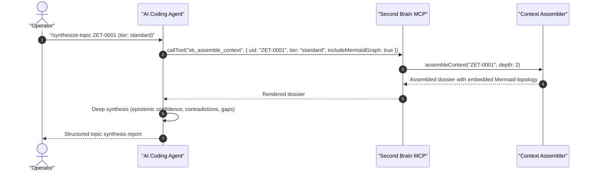

# /synthesize-topic — Topic Synthesis Skill

This skill retrieves multi-hop knowledge subgraphs surrounding a focal note or concept and synthesizes an authoritative summary respecting strict token budgets.

---

## Instructions

1. **Identify Focal UID:**
   Locate the focal note UID via `sb_search_knowledge(query)` if the user provided a topic phrase instead of an exact UID.
2. **Select Context Tier:**
   * `frugal`: For quick targeted answers ($\le 4\text{k}$ tokens).
   * `standard`: For standard thematic analysis ($\le 16\text{k}$ tokens).
   * `panoramic`: For deep comprehensive reviews or MOC creation ($\le 64\text{k}$ tokens).
3. **Assemble Context:**
   Invoke `sb_assemble_context(uid, tier, includeMermaidGraph: true)`.
4. **Deliver Synthesis:**
   Present the synthesis highlighting:
   * Core thesis and epistemic certainty
   * Supporting evidence and conceptual lineage
   * Counterarguments and unresolved contradictions
   * Recommended new research directions or atomic notes to capture

