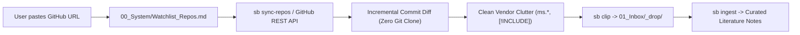

# GitHub Documentation Watchtower Skill

This skill allows agents to track public GitHub repositories and automatically ingest documentation updates into the Second Brain vault.

## Usage

1. **Add Repository to Watchlist:**
   * Append bare GitHub URL: `https://github.com/owner/repo`
   * Or subpath filter: `https://github.com/owner/repo/tree/main/docs`
   * Or via CLI: `sb watch-repo <url> [--vault <path>]`

2. **Run Incremental Sync & Ingest:**
   * Via CLI: `sb sync-repos --ingest --vault <path>`
   * Via MCP: `sb_sync_watched_repos` or `sb_ingest_sources`

