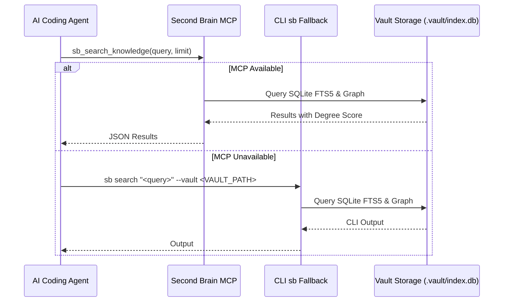

# Second Brain Knowledge Base Integration Rule

This workspace integrates with a local Second Brain vault for deep cross-project knowledge access.

## Search Guidance
1. Always prefer native MCP tools (`sb_search_knowledge`, `sb_inspect_page`, `sb_get_node_graph`).
2. If MCP tools are unavailable, invoke the CLI:
   * `sb search "<terms>" --vault <VAULT_PATH>`
   * `sb page "<uid-or-title>" --vault <VAULT_PATH>`
   * `sb related "<uid-or-title>" --vault <VAULT_PATH>`
3. Always cite the note UID (e.g. `ZET-0001`, `CON-0042`) and its epistemic confidence when quoting knowledge base findings.
4. Auto-clip public source URLs via `sb clip "<url>" --vault <VAULT_PATH>` or `sb_clip_web_source` to preserve knowledge provenance.
