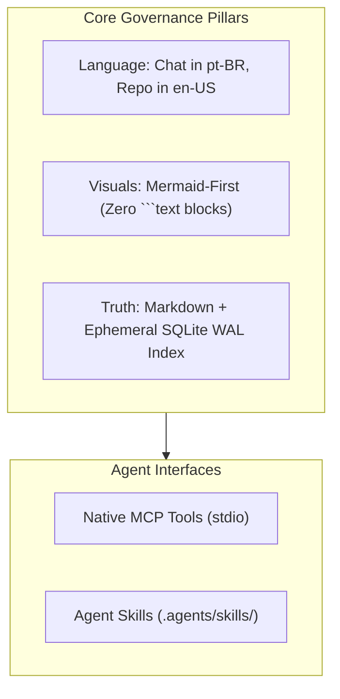

# Second Brain Framework & Multi-Agent Operating Contract

This document establishes the universal operating protocol for AI coding agents (Google Antigravity, Anthropic Claude Code, Cursor) and human knowledge curators working in this workspace.



---

## 1. Bilingual Governance

* **Human Dialogue:** The AI agent must communicate with the user strictly in **Portuguese (pt-BR)** during chat interactions in the IDE.
* **Code & Documentation:** All repository code, comments, documentation, ADRs, schemas, commit messages, and note contents must be written strictly in **English (en-US)**.
* **Exceptions:** Third-party raw source material placed inside `INPUT/` remains in its original language as raw data.

---

## 2. Mermaid-First Visual Standards (Zero ASCII Art)

* Never use ````text````, ````plaintext````, or ASCII trees (`├──`, `└──`, `|--`) in Markdown documents.
* Always represent folder structures, graph relationships, workflows, and lifecycles using native **````mermaid````** diagrams (`flowchart`, `graph`, `erDiagram`, `sequenceDiagram`, `stateDiagram-v2`, `mindmap`).
* Always wrap node labels containing spaces, brackets, parentheses, or punctuation in double quotes.

---

## 3. Native Model Context Protocol (MCP) Tools

When interacting with the Second Brain vault, agents prioritize executing operations via the 10 canonical MCP tools exposed over `stdio`:

1. `sb_assemble_context`: Assembles a token-budgeted 3-tier RAG context dossier (`frugal` $\le 4\text{k}$, `standard` $\le 16\text{k}$, `panoramic` $\le 64\text{k}$) with optional Mermaid relationship topology.
2. `sb_search_knowledge`: Searches notes across the vault using hybrid FTS5 BM25 text ranking and graph degree centrality scoring.
3. `sb_inspect_page`: Inspects a candidate note's epistemic provenance, status, confidence, sources, headings, and connected neighbors.
4. `sb_clip_web_source`: Securely clips a web URL or scraped Markdown to the vault's Inbox with cryptographic SHA-256 sidecar, credential scanning, and deduplication.
5. `sb_get_node_graph`: Retrieves the directed graph neighborhood (inbound and outbound edges) of a node to a specified depth.
6. `sb_upsert_node`: Atomically creates or updates a vault note with Zod frontmatter validation and immediate SQLite index synchronization.
7. `sb_lint_vault`: Runs a vault health audit checking broken wiki-links, orphan zettels, and schema violations.
8. `sb_index_vault`: Triggers a full or incremental rebuild of the SQLite lexical and graph database (`.vault/index.db`).
9. `sb_vault_stats`: Retrieves knowledge graph density metrics and centrality distribution.
10. `sb_create_from_template`: Scaffolds a new note instantiated from a canonical template.

---

## 4. Official Agent Skills

The framework provides specialized agent skills located in `.agents/skills/` and invocable via slash commands:

* `/new-brain`: Bootstraps a production-grade, local-first Second Brain vault with canonical PARA folders, Zod schemas, SQLite WAL index, and dual MCP configurations.
* `/migrate-notes`: Migrates legacy Markdown files and native DOCX documents into canonical Second Brain notes, automatically converting ASCII trees into native Mermaid diagrams and normalizing YAML frontmatter.
* `/synthesize-topic`: Synthesizes a broad knowledge topic across notes using 3-tier RAG context assembly, multi-hop graph neighborhoods, and dynamic Mermaid topology diagrams.
* `/capture-zettel`: Captures an atomic Zettelkasten note with schema-validated YAML frontmatter, typed semantic relations, and immediate SQLite index synchronization.
* `/audit-brain`: Audits the entire Second Brain vault for broken wiki-links, orphan zettels, frontmatter schema errors, and unlinked mentions, providing automated repair recommendations.
* `/deep-research`: Coordinates epistemic 3-level research (Local Project -> Second Brain Vault -> Web Search + Inbox Auto-Clip).

---

## 5. Storage Contract

* Markdown files with YAML frontmatter are the **sole durable truth**.
* The SQLite database (`.vault/index.db`) is derived ephemeral state that can be purged or rebuilt at any time via `sb index` or `sb_index_vault`.
