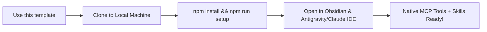

# Second Brain Vault Template (v1.5.2)

Production-grade, local-first **Second Brain (PKM) Vault** powered by the **Second Brain Framework Engine**.



---

## Quickstart Guide

### 1. Installation
Ensure you have **Node.js >= 22** installed, then in your cloned vault directory run:

```bash
npm install
npm run setup
```

`npm run setup` will index your vault into an ephemeral SQLite WAL database (`.vault/index.db`) and execute the comprehensive 14+ invariant Doctor audit.

### 2. Available Commands (`sb` / `npm run`)

* **Rebuild Index:** `npm run index` or `npx sb index .`
* **Real-time File Watcher:** `npm run watch` or `npx sb watch .`
* **Vault Doctor Health Audit:** `npm run doctor` or `npx sb doctor .`
* **Harvest Documentation from GitHub:** `npm run sync-repos`
* **Wire an External Software Project:** `npx sb connect-workspace <project-path> --vault .`
* **Start stdio MCP Server:** `npm run mcp`

---

## Multi-Agent IDE Integration

This vault is pre-configured with **Dual MCP Support**:
* **Google Antigravity IDE:** Pre-wired via `.agents/mcp_config.json`.
* **Anthropic Claude Code & Cursor:** Pre-wired via `.mcp.json`.

All canonical slash skills (`/new-brain`, `/capture-zettel`, `/synthesize-topic`, `/audit-brain`, `/deep-research`, `/migrate-notes`, `/watch-repos`) are ready in `.agents/skills/`.

---

## Automated Documentation Watchtower

Add any public GitHub documentation URL to `00_System/Watchlist_Repos.md`.
The bundled GitHub Actions workflow (`.github/workflows/nightly-repo-sync.yml`) will automatically check for upstream updates every night at 03:00 UTC and commit fresh documentation into your vault!
